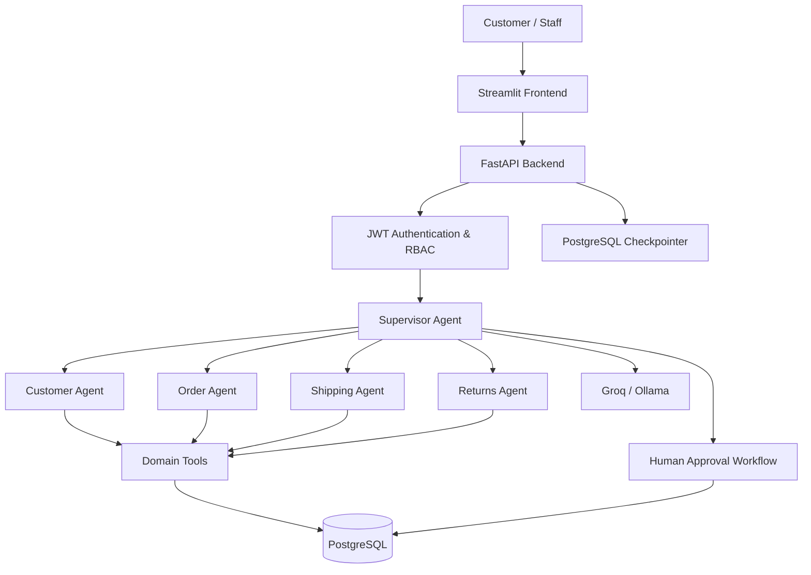

# E-commerce Customer Support Multi-Agent System

An AI-powered customer support platform built with **LangGraph, LangChain, FastAPI, PostgreSQL, and Streamlit**. The system uses specialized AI agents to handle customer inquiries, retrieve order and shipment information, manage returns, and support sensitive operations through role-based authorization and human approval workflows.

## Overview

This project provides an intelligent customer support solution for e-commerce businesses.

Instead of relying on a single AI agent, the system uses a **Supervisor Agent** to coordinate multiple specialized agents. Each agent is responsible for a specific business domain and can interact with the database through controlled tools.

The platform also includes authentication, role-based access control, audit logging, conversation persistence, and a Streamlit interface.

## Key Features

### Multi-Agent Architecture
- Supervisor Agent for request analysis and agent routing.
- Customer Agent for customer-related inquiries.
- Order Agent for order information and operations.
- Shipping Agent for shipment tracking and updates.
- Returns Agent for return and refund-related operations.
- LangGraph workflows with tool calling and state management.

### Customer Support Operations
- Retrieve customer profiles and support information.
- View order details and order status.
- Track shipments using order and tracking information.
- Create and manage return requests.
- Handle refund-related operations.
- Maintain conversation history.

### Security and Access Control
- User registration and login.
- JWT-based authentication.
- Secure password hashing using Argon2.
- Role-Based Access Control (RBAC).
- Customer data isolation.
- Protected administrative operations.
- Audit logs for sensitive operations.

### Human-in-the-Loop
- Approval workflow for sensitive actions.
- Pending approval retrieval.
- Authorized approval and execution.
- Controlled execution of sensitive business operations.

### Reliability and Error Handling
- Centralized LLM provider configuration.
- Agent error handling.
- Integration and authorization tests.
- PostgreSQL-backed conversation checkpointing.

### Deployment
- Docker and Docker Compose.
- PostgreSQL container with persistent volume.
- FastAPI backend.
- Streamlit frontend.
- Health checks and database initialization.

## System Architecture



## Technology Stack

| Technology | Purpose |
|---|---|
| Python | Core programming language |
| LangGraph | Multi-agent orchestration and workflows |
| LangChain | LLM integration and tool calling |
| Groq | Cloud LLM inference |
| Ollama | Optional local LLM inference |
| FastAPI | Backend REST API |
| Streamlit | Interactive frontend |
| PostgreSQL | Relational database and persistence |
| SQLAlchemy | ORM and database operations |
| JWT | Authentication |
| Argon2 | Password hashing |
| Docker | Containerization |
| Pytest | Automated testing |

## Project Structure

```text
Customer Support Multi-Agent System/
│
├── agents/
│   ├── customer_agent.py
│   ├── order_agent.py
│   ├── shipping_agent.py
│   ├── returns_agent.py
│   ├── supervisor_agent.py
│   ├── llm_factory.py
│   └── error_handling.py
│
├── api/
│   ├── api.py
│   └── auth.py
│
├── database/
│   ├── db.py
│   ├── models.py
│   ├── queries.py
│   ├── operations.py
│   ├── audit.py
│   └── seed.py
│
├── graph/
│   ├── state.py
│   ├── nodes.py
│   ├── workflow.py
│   └── approval.py
│
├── security/
│   ├── security.py
│   └── dependencies.py
│
├── tools/
│   ├── customer_tools.py
│   ├── order_tools.py
│   ├── shipping_tools.py
│   └── returns_tools.py
│
├── frontend/
│   └── app.py
│
├── tests/
│   ├── conftest.py
│   ├── test_api.py
│   ├── test_admin_auth.py
│   ├── test_agent_failures.py
│   ├── test_approval_integration.py
│   ├── test_customer_data_isolation.py
│   ├── test_memory_integration.py
│   ├── test_operations.py
│   ├── test_sensitive_action_detection.py
│   ├── test_supervisor_routing.py
│   └── test_tools.py
│
├── .dockerignore
├── .env.example
├── .gitignore
├── Dockerfile
├── docker-compose.yml
├── requirements.txt
├── main.py
└── README.md
```

## Getting Started

### Prerequisites

- Docker Desktop with Docker Compose, or Docker Engine with Docker Compose.
- A Groq API key for cloud LLM inference.
- Git.

### 1. Clone the Repository

```bash
git clone YOUR_REPOSITORY_URL
cd "Customer Support Multi-Agent System"
```

### 2. Configure Environment Variables

Create your local environment file:

```bash
cp .env.example .env
```

Edit `.env` and configure your credentials:

```env
# Database
DB_HOST=localhost
DB_PORT=5433
DB_NAME=customer_support
DB_USER=support_user
DB_PASSWORD=your_database_password

# LLM Provider
LLM_PROVIDER=groq
LLM_MODEL=openai/gpt-oss-120b
LLM_TEMPERATURE=0
GROQ_API_KEY=your_groq_api_key

# Local Ollama Alternative
OLLAMA_BASE_URL=http://localhost:11434
OLLAMA_MODEL=qwen2.5:3b

# Authentication
JWT_SECRET_KEY=your_long_random_secret
JWT_ALGORITHM=HS256
ACCESS_TOKEN_EXPIRE_MINUTES=30
```

**Security:** Never commit `.env` or expose API keys, database passwords, or JWT secrets.

### 3. Build and Start the Application

```bash
docker compose up -d --build
```

This starts:

- PostgreSQL database.
- Database initialization service.
- FastAPI backend.
- Streamlit frontend.

### 4. Access the Application

| Service | URL |
|---|---|
| Streamlit Frontend | http://localhost:8501 |
| FastAPI Backend | http://localhost:8000 |
| API Documentation | http://localhost:8000/docs |
| Health Check | http://localhost:8000/health |

### 5. Check Container Status

```bash
docker compose ps
```

View application logs:

```bash
docker compose logs -f api
```

Stop the application:

```bash
docker compose down
```

Database data is stored in a persistent Docker volume.

## Authentication and Roles

The API uses JWT authentication to protect user-specific and administrative operations.

The authorization layer supports roles such as:

- `customer`
- `support_agent`
- `shipping_agent`
- `returns_agent`
- `admin`

Access to sensitive operations is restricted according to user permissions.

## Testing

The project includes automated tests covering:

- API endpoints.
- Authentication and administrative authorization.
- Customer data isolation.
- Agent failures and error handling.
- Supervisor routing.
- Tool execution.
- Return and refund operations.
- Human approval workflows.
- Conversation memory integration.

Run the test suite:

```bash
pytest -v
```

**Latest recorded test result:** 161 passed.

## LLM Provider Configuration

The application supports multiple LLM providers through a centralized model factory.

**Groq (Cloud):**

```env
LLM_PROVIDER=groq
LLM_MODEL=openai/gpt-oss-120b
```

**Ollama (Local):**

```env
LLM_PROVIDER=ollama
OLLAMA_MODEL=qwen2.5:3b
```

The selected provider is configured through environment variables without changing individual agent implementations.

## Future Improvements

- Cloud deployment and public access.
- Production monitoring and observability.
- Improved API rate limiting.
- Enhanced automated evaluation of agent responses.
- Additional e-commerce integrations.
- Expanded reporting and analytics.

## Author

**Ali Mahmoud Ali**

Computer and Data Science Student  
Alexandria University

Interested in AI Engineering, Machine Learning, and Multi-Agent Systems.
